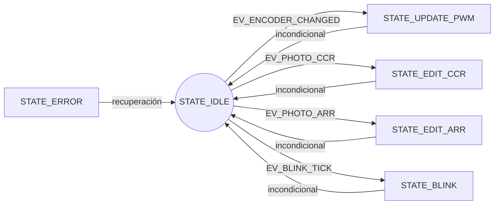

# Taller Máquina de Estados: Encoder y PWM (STM32F411 / NUCLEO-F411RE)

Monitoría de Electrónica Digital — 2026-2S

## 0. Objetivo del taller

En los talleres anteriores se usaron timers, interrupciones y una máquina de
estados sencilla (el semáforo). Ahora el foco está **solo en la máquina de
estados**: el hardware (pines, timers, EXTI) ya viene configurado y lo que se
escribe es la lógica que lo gobierna.

El programa final controla una **señal PWM** con un **encoder rotatorio**:

- El encoder sube o baja un valor cada vez que se gira.
- Dos **fotocompuertas** eligen *cuál* valor cambia el encoder: el **ancho del
  pulso** (`CCR1`) o el **periodo** (`ARR`) del PWM.
- Un **LED** parpadea más rápido o más lento según lo que se esté editando.

Al terminar el estudiante debe poder:

1. Explicar qué es un estado, un evento y una transición.
2. Dibujar la máquina de estados de este programa con `IDLE` en el centro.
3. Explicar por qué las interrupciones solo levantan banderas y el `main` hace
   el trabajo.
4. Usar el debugger para ver cómo cambian `current_state` y las banderas.

---

## 1. Montaje

| Elemento                | Pin  | Para qué sirve                                   |
|-------------------------|------|--------------------------------------------------|
| Salida PWM (TIM3 CH1)   | PA6  | Señal que se mide con osciloscopio o analizador  |
| Encoder, CLK (TIM2 CH1) | PA0  | Una de las dos señales del encoder               |
| Encoder, DT (TIM2 CH2)  | PA1  | La otra señal del encoder                        |
| Fotocompuerta 1         | PB8  | Elige editar el **ARR** (periodo)                |
| Fotocompuerta 2         | PA12 | Elige editar el **CCR1** (ancho del pulso)       |
| LED                     | PH1  | Muestra el modo con su velocidad de parpadeo     |

Las dos fotocompuertas generan una **interrupción externa (EXTI)** en el flanco
de **bajada**: la interrupción ocurre cuando la salida pasa de 1 a 0.

El proyecto se crea igual que en los talleres anteriores (extensión de STM32
para VS Code, proyecto **CMake**, board `NUCLEO_F411RE`). El código de este
taller va en el archivo principal del proyecto dentro de `Src/`.

---

## 2. La configuración inicial

El profesor entrega un archivo llamado `mainME_configinicial.c`. Su contenido
se pega como punto de partida. Ya trae todo el **hardware** configurado:

| Función              | Qué configura                                                              |
|----------------------|----------------------------------------------------------------------------|
| `init_GPIO()`        | Los pines: PH1 como salida; PB8 y PA12 como entradas; PA6, PA0 y PA1 con su función alterna |
| `init_EXTI()`        | Las interrupciones externas de PB8 (línea 8) y PA12 (línea 12), por flanco de bajada |
| `init_timer4()`      | El TIM4, que interrumpe cada 250 ms (la base de tiempo del LED)            |
| `init_timer3PWM()`   | El TIM3 como generador de PWM en PA6: 500 Hz y ancho de pulso 0 al inicio  |
| `init_tim2_encoder()`| El TIM2 en modo encoder 3: cada paso del encoder suma o resta **4 cuentas** a `TIM2->CNT` |

Lo que **no** trae, y es lo que se construye en el taller:

1. Los **estados** y los **eventos** de la máquina.
2. Las **variables** que comunican las interrupciones con el `main`.
3. Las **rutinas de interrupción** (ISR): `TIM4_IRQHandler`,
   `EXTI9_5_IRQHandler` y `EXTI15_10_IRQHandler`.
4. Las **funciones auxiliares** (leer el encoder, aplicar los cambios al PWM,
   cambiar el LED).
5. El `switch` dentro del `while(1)`.

> Sin las ISR, la primera vez que una fotocompuerta o el TIM4 interrumpa, el
> micro saltará a un manejador por defecto y se quedará atascado. Por eso las
> ISR hacen parte de lo que se debe escribir.

---

## 3. Qué es una máquina de estados

Una **máquina de estados finitos (FSM)** es una forma de organizar un programa
para que "recuerde en qué situación está" y reaccione distinto según esa
situación. Tiene cuatro ingredientes:

| Concepto       | Significado                                                        | Ejemplo en este taller                  |
|----------------|--------------------------------------------------------------------|-----------------------------------------|
| **Estado**     | La situación en la que está el sistema en un instante              | "Estoy editando el CCR"                 |
| **Evento**     | Algo que ocurre y puede cambiar el estado                          | "Se giró el encoder"                    |
| **Transición** | El paso de un estado a otro cuando ocurre un evento                | De `IDLE` a otro estado al girar el encoder |
| **Acción**     | Lo que se ejecuta al llegar a un estado o durante la transición    | Cambiar el `CCR1` del PWM               |

### 3.1 Por qué el programa no se bloquea

El `while(1)` **nunca espera**: en cada vuelta mira si pasó algo, hace como
máximo una cosa y vuelve a empezar. No existe un `delay` que detenga el
programa. Esto se logra con dos reglas:

1. Las **ISR** son cortas: solo anotan en una variable que algo ocurrió (una
   **bandera**) y regresan.
2. El `main` lee las banderas, las convierte en **un evento** y la máquina
   decide qué hacer.

Las banderas que cambian dentro de una ISR se declaran `volatile`, igual que
`cambio` en el taller anterior.

### 3.2 `IDLE`: el estado central

El estado `STATE_IDLE` es el **centro** de la máquina: es el único que
consulta si hay eventos. Cuando llega uno, `IDLE` pasa a un estado que
atiende **esa única tarea** y luego regresa a `IDLE`. Así, mientras no pasa
nada, el programa simplemente da vueltas en `IDLE`.

---

## 4. La máquina de estados del taller

### 4.1 Diagrama

Cada flecha lleva el **evento** que provoca la transición. Las flechas que
regresan a `IDLE` no esperan ningún evento (se dicen *incondicionales*).

Lectura rápida: desde `IDLE` salen cuatro flechas con evento; todos los
estados vuelven a `IDLE`.

### 4.2 Estados

| Estado              | Qué hace al entrar (acción)                                                       |
|---------------------|-----------------------------------------------------------------------------------|
| `STATE_IDLE`        | Nada. Es el único que consulta si hay un evento.                                  |
| `STATE_UPDATE_PWM`  | Aplica los pasos del encoder al valor que se esté editando (CCR1 o ARR)           |
| `STATE_EDIT_CCR`    | Fija el modo "editar el ancho del pulso" y pone el blinky en 250 ms               |
| `STATE_EDIT_ARR`    | Fija el modo "editar el periodo" y pone el blinky en 500 ms                       |
| `STATE_BLINK`       | Cambia el estado del LED PH1                                                      |
| `STATE_ERROR`       | Estado de seguridad: si la variable del estado queda con un valor imposible, se recupera hacia `IDLE` |

### 4.3 Eventos

| Evento               | Cuándo ocurre                                                              |
|----------------------|----------------------------------------------------------------------------|
| `EV_NONE`            | No pasó nada                                                               |
| `EV_ENCODER_CHANGED` | El encoder avanzó o retrocedió al menos un paso completo                   |
| `EV_PHOTO_CCR`       | Se activó la fotocompuerta de PA12                                         |
| `EV_PHOTO_ARR`       | Se activó la fotocompuerta de PB8                                          |
| `EV_BLINK_TICK`      | Venció el tiempo del TIM4 (250 ms o 500 ms según el modo)                  |

### 4.4 Transiciones

| Estado actual      | Evento               | Estado siguiente   |
|--------------------|----------------------|--------------------|
| `STATE_IDLE`       | `EV_ENCODER_CHANGED` | `STATE_UPDATE_PWM` |
| `STATE_IDLE`       | `EV_PHOTO_CCR`       | `STATE_EDIT_CCR`   |
| `STATE_IDLE`       | `EV_PHOTO_ARR`       | `STATE_EDIT_ARR`   |
| `STATE_IDLE`       | `EV_BLINK_TICK`      | `STATE_BLINK`      |
| `STATE_UPDATE_PWM` | (incondicional)      | `STATE_IDLE`       |
| `STATE_EDIT_CCR`   | (incondicional)      | `STATE_IDLE`       |
| `STATE_EDIT_ARR`   | (incondicional)      | `STATE_IDLE`       |
| `STATE_BLINK`      | (incondicional)      | `STATE_IDLE`       |
| `STATE_ERROR`      | (cualquiera)         | `STATE_IDLE`       |

### 4.5 Comportamiento esperado

- Al arrancar, el modo es **CCR**: el LED parpadea cada 250 ms y el encoder
  cambia el ancho del pulso (suma o resta 10 µs por paso).
- La fotocompuerta de **PB8** cambia al modo **ARR**: el LED parpadea cada
  500 ms y el encoder cambia el periodo (suma o resta 20 µs por paso).
- La fotocompuerta de **PA12** vuelve al modo **CCR**.
- Los valores tienen límites: el `ARR` se queda entre 99 y 65534, y el
  `CCR1` entre 0 y `ARR + 1`.

---

## 5. Qué debes implementar

Sigue estos pasos **en orden**. Después de cada uno compila; si algo no
compila, no avances.

### Paso 1. Constantes
Los valores fijos (cuentas por paso del encoder, tamaño de cada paso del `CCR1`
y del `ARR`, límites del `ARR`, tiempos del blinky) se declaran como variables
`const` al comienzo del archivo, **no** con `#define`. Usa nombres que digan
qué son.

### Paso 2. Estados y eventos
Declara un `enum` para los **estados** y otro para los **eventos**, con
`typedef`. Los nombres están en las tablas 4.2 y 4.3. El `enum` de estados debe
terminar con un valor extra, `NUM_STATES`, que no es un estado: sirve para
saber cuántos hay y comprobar que la variable del estado no se salió de rango.
Va después de las constantes y antes de `main`.

### Paso 3. Variables
Necesitas:

- La variable del **estado actual** (inicia en `STATE_IDLE`).
- Una variable que recuerde **cuál modo de edición** se eligió por última vez
  (inicia en `STATE_EDIT_CCR`).
- Una bandera `state_entry_flag` que vale 1 al llegar a un estado para que su
  acción de entrada se ejecute **una sola vez**.
- Tres banderas `volatile` para las ISR: una por fotocompuerta y una para el
  blinky.
- Los valores actuales del `ARR` y del `CCR1` (con signo, para poder compararlos
  con los límites).

### Paso 4. Las ISR
Escribe las tres rutinas de interrupción. Las tres hacen lo mismo en esencia:

1. **Bajan** la bandera de hardware que causó la interrupción (si no, la
   interrupción se repite sin parar).
2. **Suben** la bandera de software que le corresponde.

Pistas:
- En `TIM4`, la bandera de hardware es `UIF` en `SR`, y se baja escribiendo 0.
- En EXTI, la bandera es el bit de `EXTI->PR` y se baja escribiendo **1**.
- Las líneas 5 a 9 comparten un solo manejador, y las líneas 10 a 15 otro.
  Dentro del manejador hay que comprobar **cuál** línea disparó antes de
  actuar.

### Paso 5. Funciones auxiliares
Escribe estas funciones (declara su cabecera antes de `main` y defínelas
después):

| Función               | Qué hace                                                                    |
|-----------------------|-----------------------------------------------------------------------------|
| `get_next_event()`    | Revisa las banderas y el encoder, y devuelve **un** evento. Si hay varios, usa esta prioridad: fotocompuertas, luego encoder, luego blinky |
| `encoder_TakeSteps()` | Devuelve cuántos pasos completos hay en `TIM2->CNT` (con signo) y los descuenta |
| `ccr_ApplySteps()`    | Suma los pasos al `CCR1`, lo limita y lo escribe en el timer                |
| `arr_ApplySteps()`    | Suma los pasos al `ARR`, lo limita y lo escribe en el timer                 |
| `led_Toggle()`        | Invierte el estado de PH1                                                   |

Pistas:
- Un paso del encoder son **4 cuentas**. El contador es de 32 bits sin signo:
  al girar hacia atrás desde 0, `CNT` pasa a un valor enorme. Para detectar el
  sentido, trátalo **con signo**.
- Descuenta solo las cuentas usadas: si hay 7 cuentas, se aplica 1 paso y
  quedan 3 para la siguiente vez.
- Un `ARR` más corto puede dejar el `CCR1` más grande que el periodo; revisa
  ese caso.

### Paso 6. El `switch`
Dentro del `while(1)`, y sin bloquear:

1. **Antes** del `switch`, comprueba que el estado esté dentro de rango; si no
   lo está, pasa a `STATE_ERROR`.
2. Un `case` por estado. Cada uno tiene una parte de **entrada** (se ejecuta
   una sola vez gracias a `state_entry_flag`).
3. Solo `STATE_IDLE` consulta `get_next_event()` y decide la siguiente
   transición; los demás ejecutan su acción y vuelven a `STATE_IDLE`.
4. `STATE_ERROR` y `default:` comparten código: regresan a `STATE_IDLE`.

Cada vez que cambies de estado, **levanta** `state_entry_flag` para que el
estado nuevo ejecute su acción de entrada.

### Paso 7. Probar
1. Con el programa corriendo, verifica que PH1 parpadee a 250 ms.
2. Gira el encoder: el ancho del pulso en PA6 debe cambiar.
3. Activa la fotocompuerta de PB8: el LED debe pasar a 500 ms y el encoder
   debe cambiar el periodo.
4. Activa la de PA12: vuelve al modo CCR.

---

## 6. Depuración paso a paso

Estas son las pruebas que se hacen con el debugger (igual que en los talleres
anteriores, configuración `STM32Cube: STM32Launch STLink GDB Server`).

1. **Breakpoint en cada ISR.** Activa una fotocompuerta y comprueba que el
   programa se detiene dentro de la ISR correcta. Si nunca se detiene, revisa
   la configuración de EXTI.
2. **Breakpoint en cada `case` del `switch`.** Ejecuta con *Continue* y mira
   cómo recorre los estados: siempre vuelve a `STATE_IDLE`.
3. **Watch.** Agrega estas expresiones al panel Watch:
   `current_state`, la variable del modo de edición, las tres banderas,
   `TIM2->CNT`, `TIM3->CCR1`, `TIM3->ARR` y `TIM4->ARR`.
4. **Registros.** Con el panel de periféricos observa cómo cambia
   `TIM3->CCR1` o `TIM3->ARR` al girar el encoder, según el modo.

Preguntas para guiar lo que debes observar:

- ¿Cuántas cuentas suma `TIM2->CNT` por cada paso del encoder?
- Al activar una fotocompuerta, ¿cuántas vueltas del `while(1)` pasan hasta que
  la máquina llega al estado de edición?
- ¿Qué valor tiene `TIM4->ARR` en cada modo?

---

## 7. Ejercicios

1. Dibuja la máquina de estados **sin mirar** el diagrama de la sección 4, solo
   con las tablas de estados y eventos. Compara con el diagrama.
2. ¿Por qué las ISR no cambian directamente el `CCR1` ni el LED? ¿Qué problema
   aparecería si lo hicieran?
3. ¿Qué pasaría si se quitara `volatile` de las banderas? Piensa en lo que hace
   el compilador con una variable que el `while(1)` lee y nunca escribe.
4. Si se activan las dos fotocompuertas casi a la vez, ¿cuántos eventos se
   procesan por vuelta del `while(1)`? ¿Qué pasa con el otro?
5. ¿Qué sentido tiene `STATE_ERROR`, si el estado solo cambia dentro del
   propio `switch`?
6. Agrega un estado nuevo `STATE_LOCKED` que, mientras esté activo, ignore al
   encoder. Decide qué evento lo activa y cuál lo desactiva, dibújalo en el
   diagrama y escribe los cambios necesarios en el código.
7. Con el debugger, observa el primer parpadeo del LED justo después de
   arrancar. ¿Dura lo mismo que los siguientes? Anota qué ves y propón una
   explicación.
